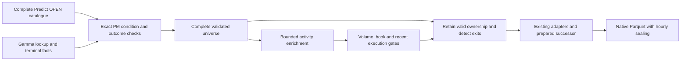

# Matched sports discovery and recording

The product contract is automatic discovery, exact cross-venue matching, bounded
recording selection and subscription handover. The operator entrypoint is
[matched sports capture](../how_to/matched-sports-capture.md).
Offline consumers read sealed Native Parquet; capture has no strategy or analysis worker.

## Ownership and flow

| Owner | Responsibility |
| --- | --- |
| Predict HTTP sports module | Complete catalogue pagination, bounded activity pages, statistics and public market data |
| CLI discovery | Exact equivalence, terminal facts, activity budgets and admission ranking |
| Core paired-market types | Configuration, condition identity and explicit token direction |
| Generation-scoped inbox | Deliver the latest refresh to the active capture actor |
| Capture actor | Active/prepared ownership, readiness, promotion, retry and retirement |
| Existing venue adapters | Instrument definitions, subscriptions, reconnect and Native events |
| Core sinks | Persistence admission, partial/hourly sealing and quality metadata |

The join key is `(Predict market ID, PM condition ID)`, with an explicit
`Predict indexSet -> PM asset/instrument` binding. Titles and slugs do not replace
identity. Each full match and map/game is an independent recording unit.

## Discovery and admission are separate

Catalogue pagination must complete within `max_pages` and the 120-second scan
deadline. Exhausted page budgets, repeated identities/cursors, unreadable mapped Gamma
markets and unknown PM closure fail the refresh. The actor retains the previous
complete universe after a discovery failure; partial data never means closure.

Every safely matched pair enters the validated universe, including quiet markets
and those outside the enrichment budget. First exclude new activity candidates
with unavailable/insufficient PM 24h volume or disabled PM books. When this pool
exceeds `max_activity_candidates`, request bounded per-tag market pages sorted
by `VOLUME_24H_DESC`. Filter returned IDs through the validated catalogue; the
list endpoint does not establish binding or closure. Confirmed live candidates
have priority, including those outside returned pages. Remaining candidates use
merged per-tag positions and stable ID, before applying the statistics cap.
The truncated shortlist is explicitly reported in selection metadata.

Only this bounded set receives Predict market statistics, at most eight requests
at a time. Statistics or ranked-list failure defers the affected admissions and
preserves complete binding/terminal facts. It does not prevent independent exits.
After bilateral volume filtering, rank by live phase, Predict 24h volume, PM 24h
volume and stable ID. A bounded final shortlist receives book and recent-execution
checks. Future events qualify immediately if all gates pass; no warm-up timer or
start-time proximity is required.

Predict YES and each PM outcome book independently pass spread and per-side share
depth within an absolute band of each side's own best quote. Complementary depth
is never added together. Newest 50 public rows per venue establish distinct
execution seconds and latest-execution age, with truncation reported. These are
bounded activity signals, not complete turnover or unique participant counts.
Category holders are optional event-level metadata and do not affect admission.
REST supplies these inputs; website GraphQL is not a runtime dependency.

## Category and market-type scope

The same binary moneyline implementation supports the following tag profiles.
A tag enables discovery, not guaranteed bilateral activity or safe equivalence
for every market in that category. Resolve identities against the
[Predict tag catalogue](https://dev.predict.fun/get-all-tags-27399809e0) when adding categories.

| Category | Tag | Full-match winners | Map/game winners |
| --- | --- | --- | --- |
| LoL | 84 | Yes | Yes |
| CS2 | 93 | Yes | Yes |
| Dota 2 | 96 | Yes | Yes |
| Valorant | 132 | Yes | Yes |
| HoK | 1803 | Yes | Yes |
| College Football | 16 | Yes | No |
| NBA | 78 | Yes | No |
| NFL | 45 | Yes | No |
| NHL | 79 | Yes | No |
| NCAAM | 82 | Yes | No |
| Tennis | 85 | Yes, using explicit player aliases | No |
| UFC | 177 | Yes | No |
| Cricket | 97 | Yes, per condition | No |
| MLB | 142 | Yes, when eligible markets exist | No |

Use at most eight distinct tags. The example spans seven sports/esports tags;
configuration defaults retain LoL only. `include_match_winners` and
`include_map_winners` select full matches, maps or both; at least one must be true.
All candidates still require the supported PM protocol, equal nonempty rules,
matching market type/number and unambiguous outcome direction. Missing aliases
remain a rejection; fuzzy name matching is not a fallback.

Spreads, totals, handicaps, round/kill and player propositions are excluded. Their
line, period, unit, draw/push/void and overtime semantics require separate explicit
contracts. Soccer is not in the maintained profile.

## Completion and handover

Sports events overlap and have variable publication, postponement and completion
times. There is no arithmetic next slug or fixed-duration expiry as in rolling
crypto prediction windows. Each complete refresh discovers potential successors
and source terminal facts independently of admission score.

Retirement inputs include Predict category/market closure, explicit parent/map
finished state, PM market closure and identified PM parent-event completion.
For PM `ended`, use a supplied verified PM parent identity, or the sole associated
parent; require one matching raw event with `ended=true` and no `live=true`
conflict. Ambiguous, missing or conflicting event state is not terminal evidence.
Absent completion fields can delay retirement until closure. Scheduled time plus
an assumed duration never proves completion.

Valid incumbents and one optional preparation remain sticky when ranks/activity
change. A full-match slot and each map consume the same global capacity; there
is no per-sport or per-event quota. New candidates fill free slots, with at most
one additional recorded preparation across the actor.

Preparation reuses the existing adapters: four accepted definitions, three
subscribed recording instruments, initial snapshots and currently usable books
are required. PM usability comes from the Native managed cache, not a parallel
book. Preparation records immediately. Sink flush barriers precede promotion;
the successor keeps its subscriptions, books and files without replay/reset.
The ended incumbent retires after its known successor is ready. Without a
prepared or qualified successor, it retires even if unrelated quiet markets
remain in the validated universe.

Timeout seals/unsubscribes only the failed preparation and applies a cooldown.
Late metadata cannot revive it. Stop cancels both roles and retries, invalidates
the generation and preserves independent static ownership. UTC hourly sealing
applies to both roles, with PM checkpoint baselines; retirement/stop seals partial
hours. See the operator guide for recorded types and audit outputs.

## Validation and limits

Offline tests cover fixture identity/direction, unsafe matching, map filtering,
parent completion ambiguity, bounded ranked pagination, activity-budget retention,
statistics failure alongside terminal updates, first-scan historical admission,
book/history gates and deterministic ordering. Actor tests cover sticky ownership,
prepared handover with populated books, timeout/retry/late callbacks, generation
isolation and populated hourly/partial-file replay. Temporary recordings are
removed after verification.

These establish local contracts, not sustained venue activity, natural live
settlement in every category, API freshness or upstream losslessness. A bounded
shortlist can miss otherwise qualified candidates. Complete catalogue/Gamma work
still has a finite deadline; ranked preselection bounds enrichment, not that
initial identity scan. Unknown/unpublished successors, the pre-subscription
prefix, reconnect losses and upstream replay deduplication are outside the local
handover guarantee. Same-ID changed rules/bindings clear readiness; unchanged
instrument plans still need an explicit new baseline policy before continuity
across such a change can be claimed.

## Source map

- [CLI discovery](../../crates/catalog-capture-cli/src/matched_sports.rs) and its selection module.
- [Predict sports HTTP](../../crates/nautilus-predict/src/http/sports.rs).
- [Core identities/configuration](../../crates/catalog-capture-core/src/paired_markets.rs).
- [Runtime inbox/state](../../crates/catalog-capture-runtime-adapter/src/matched_sports.rs).
- [Actor handover](../../crates/catalog-capture-runtime-adapter/src/actor/matched_sports.rs).
- [Subscription lifecycle](../../crates/catalog-capture-runtime-adapter/src/actor/lifecycle.rs).
