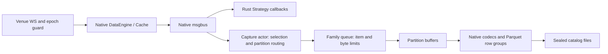

# Realtime adapter contracts

Adapters implement Native data-client contracts and own venue protocol state.
Strategies, capture actors and Native managed books consume the same typed events.
Keep normalization inside the adapter and persistence inside the capture actor.

Direct Parquet recording is a product requirement. Sealed files must be readable
by the Native catalog and backtest path without Feather staging, promotion or a
format-conversion job. Reuse Native models, codecs and catalog conventions within
that constraint; reusing an upstream mechanism does not override this requirement.

## Live/backtest consistency: acceptance contract

The primary requirement is a replayable observation stream for the same Rust
strategy, not merely a catalog that decodes or a book with the same final levels.
On a healthy interval, preserve instrument identity, outcome normalization, prices,
sizes, flags, sequences, source/ingestion timestamps and message boundaries.
Replay must also use compatible subscriptions, quote derivation and universe timing.
Matching results still depend on the simulation's latency, queue, liquidity and fee
models; common data alone cannot certify identical real and simulated fills.

Three recovery responsibilities must remain separate:

| Boundary | Authority | What a successful recovery establishes |
| --- | --- | --- |
| Venue WS / sequence gap | Venue adapter and Native BookSync/BookRecovery | A fresh venue baseline bridges buffered source diffs; publication can resume |
| Local capture admission or I/O gap | Recorder's partition continuity and quality record | Subsequent data can be stored; missing observed events remain missing |
| Replay initialization | Replay loader and an identified baseline | A new replay starts with a reconstructable book; prior strategy state is not recovered |

Binance Spot SBE already uses the upstream `book/sync.rs` tracker. It starts the
WS diff stream, buffers updates, fetches a paced REST snapshot (the current Spot
adapter requests 5,000 levels), suppresses covered updates, validates the bridge
using `U/u`, and publishes the snapshot before accepted buffered diffs. Reconnect
resets source synchronization. `book/recovery.rs` uses Native retry, timeout,
cancellation and snapshot pacing primitives. The recorder must not perform a
second venue recovery or infer Spot continuity from final `sequence + 1` alone.
Predict's complete `OrderBookDepth` observations are replacing snapshots; each
admitted depth observation already contains a baseline for that view.

The recording contract uses standard Native Parquet rows plus schema metadata for
local continuity and initialization. It introduces no staging format or conversion.

- Source fields and same-timestamp FIFO order are preserved. The L2 writer no
  longer filters covered source sequences or advances source `ts_init`. A source
  clock rollback is a failure requiring a new window, not a timestamp correction.
- Hourly managed-book snapshots are retained as marked initialization prefixes in
  the next physical file. This keeps retained hours usable after daily cleanup.
  The window reader skips intermediate prefixes; a full continuous replay sees
  only original source frames. Starting after retention may require one explicit
  initialization frame and warmup before evaluating the strategy.
- Local admission failures enqueue ordered gap controls even when data capacity
  is exhausted. A write, seal or sync failure ends the affected continuity scope.
  Process restarts and source L2 reinitialization also start new window identities.
  The quality journal remains independent evidence; a failed run can contain
  multiple individually usable windows.
- Flat `OrderBookDelta` rows are restored to Native `OrderBookDeltas` using
  `F_LAST` before BacktestEngine input. Native matching runs before DataEngine, so
  buffering only inside DataEngine cannot ensure matching sees the original frames.
- `x..A + gap + C..y` means two experiments. Create a fresh BacktestEngine,
  strategy, account and book for each window. A recovered book does not recover
  missing trades, indicators or the previous strategy's state.

The implementation is verified with one Rust strategy driven through LiveNode's
Native DataEngine and again through the real Native BacktestEngine after Parquet
readback. The test compares Native callback payloads, order, counts, decisions and
matching-input iteration count across an ordinary seal, for incremental L2/trades
and runtime-depth snapshots/trades (including more than ten levels). Native codecs normalize
placeholder precision on Clear rows; equality here is Native model equality,
not identical JSON formatting. Another test starts a separate engine and strategy
for each side of a gap and checks that its observation counter restarts at zero.
These tests use injected market data and no orders; they do not establish venue
latency, simulated fill equivalence or complete multi-feed ordering.

Limits that callers must enforce:

- Ordinary Native catalog queries decode the files but ignore capture continuity
  and initialization metadata. Use the window-aware entry below for this contract;
  concatenating raw catalog rows can inject checkpoints or bridge missing history.
- Native-only Predict recording does not preserve the selector's custom control
  stream. Strategies needing selection timing require a shared universe provider
  or recorded selection events. Loading future instrument definitions must not
  introduce selection lookahead. YES-only recording cannot supply NO/quote streams.
- Local window identities describe recorder continuity, not proof of every venue
  execution. Trade reconnect/startup coverage still requires external availability
  evidence. The window reader detects missing middle segment ordinals but cannot
  detect that the last file was deleted. Preserve quality and operational history.
- Same-timestamp order is retained within each instrument/family. There is no
  recorded global arrival ordinal across family workers; a multi-feed strategy
  needs a declared tie policy and a separate parity check.

## Durability and resource interpretation

The direct Parquet sink is durable as a queryable catalog file only after a
successful footer/close and seal. An fsync of the open file is not a Parquet
commit. The orphan recovery test proves that completed row groups can reach disk
and be fsynced while the unclosed file still cannot be recovered by the current
reader. Existing successful orphan tests close the writer before leaving `.part`;
they cover interruption before rename, not arbitrary process death. Consequently,
`sync_interval_ms=2000` does not promise a two-second recovery point. An abrupt
failure can affect the current unsealed Binance hour or Predict market segment.

Queue draining, memory flush, row-group emission and file sealing are distinct:

| Operation | Trigger | Effect |
| --- | --- | --- |
| Drain ingress | Worker wakes on admitted work | Moves a bounded queue batch to the worker; does not wait for the seal deadline |
| Flush partition buffers | Family row threshold, byte budget or interval | Passes buffered records to the Arrow writer |
| Emit row groups | Writer row/encoded-byte targets or explicit close | Writes groups; incomplete groups can remain in the encoder |
| Seal file | Rotation, retirement, capacity roll or shutdown | Completes the footer and publishes the Parquet file |

An hourly seal does not mean an hour of unflushed partition buffers. The current
profile flushes on thresholds and a two-second interval, and bounds ingress by
both items and estimated bytes. Queue growth is governed by arrival rate versus
worker service rate, including encoding, writes, fsync and seal stalls. Shorter
sealing is a crash-exposure/file-count decision, not a burst-capacity fix; it can
increase writer contention. The encoder has its own memory overhead outside the
queue and partition estimates. Batching preserves all admitted events; a two-second
flush interval does not resample the source stream to one event every two seconds.

Durability improvements must stay within direct Parquet. Evaluate bounded
time/size sealing of complete Parquet parts, retaining the existing Native schema
and catalog layout. Measure file count, compression, encoding and seal latency
before selecting shorter intervals. Physical file rotation must not create
synthetic market events. Merely flushing a row group more frequently does not
solve the missing-footer problem. State process-crash and power-loss guarantees
separately, including the applicable file and directory synchronization steps;
an in-memory queue or an unclosed part is not a committed catalog file. No tighter
crash-loss bound is implemented or established by this design note.

The 4 CPU / 8 GiB combined profile is a reasonable initial throughput budget:

| Setting | Interpretation |
| --- | --- |
| Explicit ingress limits by family | L2 32,768 / 64 MiB; Depth 8,192 / 32 MiB; trades 32,768 / 32 MiB; definitions 1,024 / 4 MiB |
| 8 MiB per partition / 64 MiB partition total | Separate from ingress and the in-flight worker batch |
| Depth 512 rows / incremental L2 20,000 rows | Encoding/compression targets, not durability deadlines |
| Two-second flush / ten-second periodic fsync | Independent deadlines; fewer periodic sync requests, neither commits a Parquet footer |
| Hourly seals, Predict retirement seals | Close files; initialization prefixes are excluded from continuous replay |
| Snappy and two threads in each async runtime | Appropriate starting settings with prebuilt deployment; validate full-load contention |

For these four families, configured queued payload budgets sum to 132 MiB.
Queued and worker-owned batches can together reach 264 MiB, in addition to the
current 216 MiB partition-buffer estimate.
Encoders, queue allocations, Native books/ingress and allocator overhead are extra.
The 1 GiB startup warning budget is not a process memory cap. The encoded 8 MiB
row-group target is not an 8 MiB encoder-memory limit either.

Size burst headroom per family using
`min(queue_entries / peak_messages_per_second, queue_bytes / peak_payload_bytes_per_second)`.
For illustration, 5,000 messages/s at 4 KiB/message consumes the 64 MiB budget in
about 3.3 seconds with a stalled writer, before all 32,768 slots are used. This is
not a measured Binance rate. Daily compressed disk use of 3–4 GB cannot establish
the peak input rate or a worst-case write stall. Keep the current throughput
limits pending full SBE measurements; increasing buffers cannot fix a slower
sustained writer or an undefined durability/replay contract.

Acceptance evidence must use the same strategy in LiveNode and BacktestEngine:
compare complete callback fields/count/order and decisions over a healthy window,
an ordinary file boundary and a market rollover; exercise same-timestamp batches,
an L2 gap and initialization separately. Test real process interruption before a
footer, during close and around rename. Existing catalog readback, final-book equality and
short Predict-only recording are useful evidence, but do not substitute for those
contracts or a multi-day full-scope server soak.

## Recording and replay policy

Keep the full recording scope, direct-Parquet format, Snappy, family row groups,
partition buffers and hourly seal schedule. The combined Predict/Binance profile
uses provisional ingress budgets: L2 32,768 items / 64 MiB; Depth 8,192 / 32 MiB;
trades 32,768 / 32 MiB; definitions 1,024 / 4 MiB. These are tunable stall budgets,
not measured peak-rate guarantees.

The Predict profiles keep `flush_interval_ms = 2000` and use
`sync_interval_ms = 10000`. Compared with two-second periodic sync, this requests
one fifth as many periodic sync passes at steady scheduling. It does not reduce
source observations or delay the independent buffer flush. Seal still syncs its
completed footer. The change reduces opportunities for storage stalls; it cannot
prevent overflow during one sufficiently long stall. Controlled worker tests
block the sync operation with both intervals and demonstrate rejection followed
by continued recording. This is a correctness test, not an SSD throughput test.

Further parameter tuning requires a release run of all six Predict selectors and
three-symbol Binance SBE on the target 4 CPU / 8 GiB host. Measure per-family peak
items/bytes, oldest queued age, in-flight load, operation durations and Linux RSS
through rollovers and seals. Optimize a measured bottleneck before enlarging queues.
Daily compressed volume does not establish burst headroom. No finite queue can
preserve every observation during an arbitrary disk outage without source replay.

Crash exposure remains a separate decision: keep hourly seals during throughput
measurement, then evaluate shorter complete-file intervals from acceptable loss,
close latency, compression and file count. No WAL or Feather staging is introduced.
Post-footer file sync and Unix directory sync are implemented; abrupt failure before
the footer can still lose the entire active part. A full-scope multi-day soak and
host power-loss testing remain outstanding.

### Faithful replay across file boundaries

`catalog_capture_core::replay` is a small consumer of the existing Native catalog.
It discovers sealed files through Native `ParquetDataCatalog`, decodes with Native
Arrow codecs and preserves physical row order. No alternate market-data model,
format conversion or backtest engine is involved.

Every standard market segment carries these schema metadata keys:

| Key | Meaning |
| --- | --- |
| `capture_contract` | `native_frames_v1` |
| `capture_window_id` | Local partition continuity identity |
| `capture_segment_index` | Ordinal within that window, advanced after a successful nonempty seal |
| `capture_initialization_rows` | Prefix row count reserved for local book initialization |

An ordinary hourly seal retains the identity and advances the ordinal. A local
gap, partition retirement, source L2 snapshot reinitialization or new process
starts a new identity. A missing middle ordinal yields separate windows instead
of silently joining the remaining files. Equal timestamp file ranges coexist via
the Native filename parser's alphanumeric suffix; publication cannot overwrite
another sealed file. Legacy files without this contract remain Native-readable
but are rejected by the window-aware reader.

`read_replay_windows::<TradeTick>` and `read_replay_windows::<OrderBookDepth>`
return independent observed windows. `read_book_replay_windows` also restores
`F_LAST` frames and supplies a usable marked baseline when starting mid-history.
Call `has_book_baseline()` before putting an L2 window into a fresh engine; an
unanchored partial window is inspectable but must not be used as initialized L2.
For a retained prefix ahead of initial queued deltas, use its exact sequence/event
anchor to omit only the startup history covered by that synthetic baseline.
Source rows remain unchanged on disk. If the anchor cannot be established, the
reader does not invent one.

Each returned window is a separate experiment. Conceptually:

```rust,ignore
let windows = read_book_replay_windows(catalog_root, instrument_id)?;
for window in windows {
    anyhow::ensure!(window.has_book_baseline(), "missing L2 baseline");
    // Construct a fresh Native BacktestEngine and strategy here.
    // Configure venue/instruments, initialize, then add this window's
    // Data::BookDeltas frames and the aligned trades/depth. Run and dispose.
    // Never append another window to the same strategy state.
}
```

`common_replay_ranges` intersects the observed ranges for all required feeds,
without merging across gap boundaries. It is conservative row-range intersection,
not venue availability certification or a warmup loader. Supply initialization and
warmup for every resulting experiment; do not carry positions, indicators or
orders over a missing interval. Reads currently materialize an instrument's local
windows in memory, opening one file at a time; this is not a streaming backtest API.

Regression coverage includes equal-time distinct source messages, physical seals,
retention of the first file, a missing middle file, repeated FIFO admission gaps,
malformed `F_LAST`, and independent Native engines after a gap. Normal replay
skips hourly prefixes; a fresh replay after retention uses a prefix only at its
initialization boundary. A plain Native catalog query does not apply this policy.

### Configuring family ingress budgets

`output.queues.<family>.capacity` and `.max_bytes` override ingress limits for a
family runtime. Each field can be omitted independently. The precedence is:

- Items: family `capacity`, then `output.queue_capacity`.
- Bytes: family `max_bytes`, then `output.queue_max_bytes`, then the legacy
  `output.max_total_buffer_bytes` fallback.

`max_total_buffer_bytes` still limits aggregate partition buffers; a queue override
does not change it, `max_buffer_bytes`, row groups, timers or other families.
Unknown family names/fields and explicit zero override limits are rejected.
Settings apply when constructing workers, so edit TOML and restart gracefully to
change them. `queue_capacity` and `queue_max_bytes` gauges expose effective limits
per family. Totals sum runtime limits; neither totals nor per-family values cap RSS.

```toml
[output.queues.book_deltas]
capacity = 32768
max_bytes = 67108864

[output.queues.book_depth]
capacity = 8192
max_bytes = 33554432

[output.queues.trades]
capacity = 32768
max_bytes = 33554432

[output.queues.instruments]
capacity = 1024
max_bytes = 4194304
```

The key names follow `CaptureFlushFamily`. Unspecified families retain fallback
limits. Separate custom selector writers each receive the configured
`custom_data` budget; that setting is per worker, not a shared process allowance.
The supplied native-only Predict profiles do not enable those custom writers.

### Pipeline observations and partition failures

The Native callback only admits work. A monotonic enqueue timestamp travels with
each FIFO entry; the worker still swaps reusable queue buffers in constant time.
Flush and fsync now use independent absolute deadlines: `flush_interval_ms`
controls partition flush, and a positive `sync_interval_ms` controls periodic
sync. Zero disables periodic sync without disabling flush. Deadline checks run
between worker batches, so a blocked operation or long batch can delay execution;
these intervals are not hard latency bounds. The Predict profiles use two-second
flush and ten-second periodic sync. Previously segment mode coupled interval flush
to the sync setting.
The following observations appear per family in JSON and Prometheus:

| Observation | Interpretation |
| --- | --- |
| `oldest_queued_seconds` | Age of the oldest entry still waiting in ingress; zero for an empty queue |
| `in_flight_items` / `in_flight_bytes` | The entire drained batch until its processing finishes; includes any seal entries in item count |
| `worker_busy_seconds` | Time since the current worker iteration began, including a blocked write or control operation |
| `active_writers` | Open segment files at the last completed worker iteration; distinct from buffered partitions |
| `operation_seconds_{count,sum,max}` | Operation label `queue_wait`, `sink_write`, `sink_sync` or `sink_seal` |

Queue-wait time is observed when each entry starts processing, including time in
the worker batch. Sink-write time includes conversion and Arrow append, but later
sync and seal are measured separately. Seal timing excludes the preceding
partition-buffer flush, which contributes sink-write observations. These are
inclusive operation measurements, not CPU-only timings or a durability promise.
Across families, loads/counts/totals sum while time maxima take the maximum; use
per-family labels to locate a bottleneck. Zero queued bytes alone cannot establish
that encoding or writes have caught up.

Each family shares a bounded `FailureTracker` between admission, the writer and
independent observers. Its capacity is `max_active_partitions` records (at least
one), with consecutive failures of the same partition/operation coalesced. A
generation cursor lets recovery observe changes without cloning metrics or
consuming the journal's view. Admission records the actual evicted partition for
`drop_oldest`, or the rejected partition for `fail_fast`/`drop_newest`. This history
uses a separate short critical section and cannot be rejected by a full data queue.
No network or filesystem I/O runs under its lock.

Write and targeted-seal failures retain partition scope. Sync or whole-family
seal failures have unknown scope through the existing sink interface and therefore
invalidate the family's recovery state conservatively. If history is evicted,
`evicted_through` makes older readers use the same conservative fallback. This
bounded history is neither a WAL nor an ordered commit acknowledgment. It does
not by itself identify safe interval endpoints. Event-time ranges, when available,
are failure observations, not proof that every event inside them was lost.

Per-family failure generations and retained records are included in quality JSONL
observations, even if a worker has not finished publishing its batch counters.
Metrics expose the recording failure as soon as the structured fault is observed.
Healthy admission and later writes continue; unavailable-worker restart policy is
unchanged. Per-partition history cannot guarantee recovery of events evicted
between journal samples; the eviction marker and failed run remain evidence of
uncertainty. The strict replay gate described above remains required.

## State ownership

| State | Owner | Meaning |
| --- | --- | --- |
| Actor/strategy interests | Native DataEngine | Logical subscriptions and shared consumer ownership |
| Synchronous acceptance | Native DataClientAdapter | Members accepted by the adapter, independently of venue ACKs |
| Desired topics and remote confirmation | Venue session | Physical stream sharing and reconnect reconciliation |
| Accepted source book | Venue session | Source ordering and a current-connection initialization snapshot |
| Managed book and callbacks | Native data processing | Applied state and subscriber-visible events |

A queued command is accepted work, not proof of a venue subscription or a ready book.
Use Native `execute_instrument_subscriptions` and `SubscriptionError` for batched
instrument operations. Validate command-wide options before effects; validate each
member inside the callback, continue after failures and report exactly the accepted
members. Apply the same contract to unsubscribe and instrument-definition updates.
A failed member must not roll back accepted members or block later valid members.

Commit desired state before awaiting transport. Once an unsubscribe has been
accepted and processed, failed remote removal must not restore its local owner.
Keep other owners; reconnect restores only the remaining desired topics. Preserve
Native's distinction between retained intent and accepted client subscriptions.

## Predict book initialization

Keep one source state per physically owned orderbook market:

- a source timestamp watermark;
- an optional complete snapshot eligible for initialization on this connection.

Older frames cannot replace Native source state. Equal timestamps may contain
different levels and remain admissible. An empty book is a valid replacement.
Keep source `ts_event` and ingestion `ts_init` when initializing a new Native stream.
This is source retention, not a claim that Native has applied a particular event.

On generation failure or reconnect, invalidate the initialization snapshot while
retaining its ordering watermark. A late depth owner also checks Native connection
activity and epoch, so an outage before `RECONNECTED` is processed cannot initialize
from the previous connection. The next admissible current-epoch frame restores
initialization readiness. Last book-owner release removes the entire state; reset
and disposal release it with the session. Ownerless and stale-epoch frames cannot
repopulate it. Source ordering is shared by YES/NO depth and quote views rather
than independently reconstructed by each consumer.

Original custom snapshot delivery keeps its recording contract. TradeTick has an
independent stream and must not use the book watermark as a filter. A consumer
joining a shared Native subscription continues to receive subsequent publications;
this cache does not add per-strategy historical replay.

## Responsive WebSocket dispatch

Keep each session the single writer of protocol state. Poll subscription-send
futures alongside inbound frames, cancellation and health checks instead of
awaiting network progress inside the main receive branch. Reuse Native transport,
epoch ownership, rate limits, SubscriptionState where applicable, and TaskGroup.

Keep one in-flight subscription write. Leave commands and Predict discovery results
in their bounded ingress queues until the subscription lane is empty. Reconnect
replay contains one request per desired physical topic; Predict snapshot confirmation
may add releases for retained handovers. Pending work is therefore bounded by the
registered interests and the one admitted command, rather than an ever-draining
command queue. Do not spawn detached writers or a task per topic. Preserve command order, heartbeat
progress and per-venue confirmation rules.
Bind sends with Native `send_text_on_connection` and compare completions against
both the observed session epoch and the transport's current epoch. Application
heartbeats use a separate, single in-flight control future; they do not wait behind
subscription quota. Discard stale completions. Reconnect
reconciles current desired state; it does not blindly replay an old unsubscribe or
an uncertain same-connection write. Data-subscription recovery is independent of
execution-command recovery and does not authorize resubmitting unknown orders.

## Implementation and evidence

| Boundary | Implementation | Regression coverage |
| --- | --- | --- |
| Native batch acceptance | Predict `data/lifecycle.rs`; Extended and Lighter Binary `data.rs` | Full/closed queues, invalid middle members, Native subscription-set retry and global rejection |
| Predict desired ownership and source lifetime | `data/runtime.rs`, `data/dispatch.rs` | Accepted release followed by real terminal write failure; shared and last owner; empty/equal/older books; late outcomes and real reconnect |
| Public send scheduling | Each venue's WS session | Native Lighter quota exhaustion while data, heartbeat and cancellation progress, bounded ingress, both transport backends |
| Strategy and recording | Predict `quote_rollover` and opt-in `catalog_readback` tests | Rust Strategy depth/trade callbacks, shared physical streams, capture rotation and Native catalog readback |
| Capture worker schedule and load | Core `background.rs`, `metrics.rs`, `metrics_export.rs` | Independent real-worker flush/sync deadlines, disabled sync, stalled writer load/age, monotonic wait timings, JSON and Prometheus observations |
| Partition failure notifications | Core `failures.rs`, `runtime.rs`; capture actor | Rejected and evicted scopes, bounded history and conservative eviction, write/control faults, and unrelated L2 deltas preserved through Native catalog readback |
| Replay continuity and initialization | Core `replay.rs`, segment metadata, FIFO gap controls | Repeated admission gaps, bounded eviction controls, equal-time frames, missing files, retention and cache-ahead initialization |
| Native strategy parity | Runtime adapter `tests/replay_windows.rs` | LiveNode vs BacktestEngine callback/decision and iteration parity for L2/trades and full depth/trades; independent engines across a gap |

Tests step private sessions through a test-only driver of the production send lane;
public integration tests run the real session loop. Historical synthetic captures
remain immutable; assertions explicitly migrate the former cancelled-owner policy.
The quota-wait test fails with the original blocking receive loop. Its deadlines
are correctness checks, not a mainnet latency benchmark or a claim that venue update
cadence changed.

## Capture resource ownership

Recording admission and rotation must preserve these additional invariants:

For unattended recording, quality failure and loss of recording capability are
different states. A rejected item or failed batch records a gap and continues
processing later input. It must not stop other markets or cancel future timers.
Only an exited/poisoned worker requests Native system shutdown for service restart.
Lifetime quality counters remain latched; a later success does not erase a gap.
Failed Arrow appenders are retired from active state before the next batch, and
uncertain parts stay outside normal catalog queries. All partitions still receive
flush/seal attempts when one partition fails. After an incremental L2 gap, resume
that instrument with a managed-book checkpoint in a fresh segment.

- Data and seal commands share one bounded FIFO. A seal flushes exactly the
  preceding data before later data or an L2 checkpoint can open the next part.
  Enqueueing a seal does not wait for encoding or disk I/O on the Native thread.
- A short writer stall is absorbed by the existing byte-limited queue. Keep
  `fail_fast`; do not evict research data, coalesce full-depth observations or
  block the event loop waiting for capacity. More slots help small-message bursts;
  the byte limit still applies. Sustained input above disk throughput cannot be
  made lossless with finite memory and a feed without replay.
- Preserve queue high-water marks between metrics scrapes. Every admission or
  write failure invalidates a clean recording result, even if subsequent writes
  succeed. Continue draining already accepted data during orderly shutdown.
- Use Native `shutdown_system` only for an unavailable worker. Ordinary admission
  and file errors preserve future recording. Always publish final metrics, including
  when shutdown sealing fails. Persist quality independently of HTTP export; after
  an operator-requested stop, a run with known gaps returns a failing CLI result.
- Quality records attest to local admission and persistence only. They cannot
  certify venue continuity across initial subscription, reconnect or process death.
- Runtime destruction drains and joins its worker, including a partially built
  actor's workers. Explicit shutdown remains the path that returns write errors.




The capture path is venue WS → Native DataEngine/cache/msgbus → capture actor →
bounded family queue → partition buffers → Native Arrow encoding → Parquet parts.
The adapter owns venue state; the actor owns recording selection; the worker owns
encoding and files. Their queues, caches and buffers have separate lifetimes.

For the six-selector Predict plus three-symbol Binance SBE profile on 4 CPU / 8 GiB:

- Preserve source cadence, full depth and every trade. Keep Snappy and hourly Binance
  seals; Predict seals retired market partitions at confirmed rollover.
- Give full depth its own 512-row profile. A snapshot contains many levels; the
  20,000-row incremental L2 profile is inappropriate for these variable-size rows.
- Bound each family queue by both item count and estimated payload bytes. Reuse
  the family queue overrides for ingress; `max_total_buffer_bytes` remains the
  partition-buffer cap and the ingress fallback for legacy configurations.
  A drained worker batch can hold another queue budget. Reuse Parquet's
  `set_max_row_group_bytes` with `max_buffer_bytes` for the encoded row-group target,
  alongside the row limit. Encoder overhead, Native transport/engine queues and
  allocator overhead are outside the partition-buffer estimate.
- Keep ingress admission/drop counters independent of worker progress, so a flush
  cannot erase overload evidence. Retain drained counters for final publication;
  count sink input rows once, rather than again when their file is sealed.
  Export queued bytes alongside queued items.
- Include rolling depth, trades and both outcome definitions in startup estimates,
  allowing current and successor markets to coexist. Estimates are not an RSS cap.
- Dynamic Predict definitions remain available while any native book/trade owner
  still needs the market, even after its selector retires. Last-owner release
  removes that registry entry; Native cache retirement is a separate consumer step.
  Venue-wide definition observers are not exact instrument owners and must not
  prevent retirement of every expired market.
- The standalone capture host needs only the latest cached tick/bar. Native
  `save_market_data=false` disables database persistence, not memory history.
  Managed L2 books remain available for boundary checkpoints. Strategy hosts retain
  their independently configured Native cache policy.

The background persistence queue is required because encoding and file I/O must not
run per tick on the Native actor thread. Its batching and partitioning are capture
policy, not a replacement for Native subscription ownership or venue sequence
recovery. Reuse Native model types, cache APIs, codecs and catalog layout.

Review boundaries that remain relevant operationally:

- Native instrument writes can return catalog-relative paths; the existing file
  byte counter uses local filesystem metadata and can undercount those files.
  Use filesystem disk usage for retention sizing. Path/byte-accounting parity is
  a separate follow-up; instrument rows are still persisted and read back.
- The Native depth subscriber-count API includes wildcard observers. A mixed
  recorder/sandbox host needs an exact depth-owner query before applying this
  retirement policy; the standalone capture host has no sandbox depth observer.
- The Predict profiles declare ingress limits per family as documented above.
  Slots include FIFO seal commands; commands cannot evict data. Ordered gap
  controls have bounded extra headroom even at full data capacity, and coalesce
  only until affected data is admitted after the previous marker. The
  worker swaps reusable queue buffers under the lock, then encodes outside it.
  Shutdown waits for admitted data and queued barriers, including after a fault.
- Every capture family retains callback failures as quality evidence and continues
  admitting later events. A periodic check detects unavailable workers even without
  further market data, and only that condition requests Native `shutdown_system`.
  The CLI checks final writer state independently of HTTP metrics and reports
  known losses when the recording is eventually stopped.
  There is no safe generic replay of a consumed batch after an uncertain write.
- Predict trades are subscribed after snapshot-confirmed selection. The venue has
  no lossless WS replay, so initial subscription and reconnect intervals cannot be
  advertised as a complete execution tape. Prewarming needs a separate ownership
  and handover design, rather than capture flags leaking into venue transport.
- Full custom snapshots still carry selector control information when snapshot
  files are disabled. Actor selection and adapter source state have different
  owners; merging their maps would break shared-strategy ownership.


The upstream Feather staging writer also uses FIFO data/control commands and a
dedicated blocking worker. Its synchronous per-request replies, Feather session
layout and promotion/recovery contract differ from this recorder's direct,
partition-sealed Parquet catalog. Replacing the recorder with that sink would
violate this project's direct-Parquet requirement. Keep Native models, codecs,
catalog paths, managed-book checkpoints and shutdown commands; retain only the
capture-specific bounded admission and partition lifecycle here.

The CLI appends `in_progress`, then `completed` or `failed` to
`metadata/capture_quality.jsonl`, keyed by a unique run ID and using Native run
status names. Preserve this history during daily cleanup. A missing terminal
record is an unfinished/unknown run. A failed interval is not a clean backtest
input just because later runs completed. These records describe local recorder
health; they do not prove that the venue delivered every execution.
Admission counters count items/messages, while flushed rows count catalog rows;
one L2 message can contain many rows. Do not compare those totals as a universal
continuity test. The Native transport/engine ingress also has its own queues;
an empty capture queue alone does not establish that upstream processing is caught up.
Use one process per catalog root: startup orphan recovery is not protected by a
cross-process writer lock. Concurrent-writer coordination is a separate contract.

For long-running processes, quality observations are appended while fault counters
change, rather than only on process exit. `/health` is a liveness check: ordinary
quality gaps do not turn it into a permanent restart trigger. `failed_workers`
reports lost worker capability; `recording_failed`, `dropped_items_total` and
`write_errors_total` retain the separate history of data quality.

Seal timers are rearmed even after an enqueue error. Data queue capacity reserves
up to `max_active_partitions` additional seal slots so seals are not starved by
a full data queue. Gap markers do not consume data admission slots. Between queue
swaps, their count is bounded by admitted payload slots plus
`max_active_partitions + 1`; another marker for the same scope requires an
intervening admitted payload. Repeated failures without one coalesce. The opt-in
oldest-eviction policy also removes redundant cuts around surviving payloads,
preventing an eviction burst from accumulating unbounded controls. Failed appends quarantine their uncertain `.parquet.failed`
files; unique `create_new` part files prevent later batches from truncating them.
All partitions receive flush, seal and fsync attempts despite another partition's
failure. Failed instrument definitions are retried from Native's retained cache.
L2 admission/write gaps trigger a full Native managed-book checkpoint, atomically
queued as a marked initialization prefix after sealing that partition; the
checkpoint already includes the triggering source update. The next experiment
starts from this baseline; it never continues the previous strategy state. Standalone Depth snapshots and trades need no L2 reconstruction.
Keep `.failed` files outside normal backtests pending inspection. A recovered L2
checkpoint restores subsequent book state, not the missing intermediate events.
